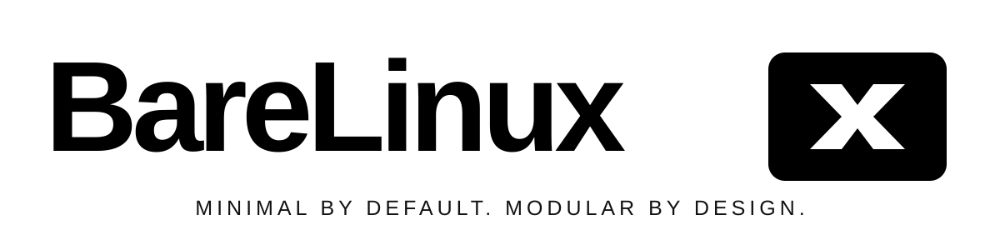

  

# BareLinux

**Minimal by default. Modular by design.**

BareLinux is an independent, x86_64 Linux distribution designed around an immutable system model and a CLI-only interface.

## Project status

BareLinux is in the early **M1 — Build Foundation** stage. The repository currently contains project configuration and foundation checks; it does not yet produce a bootable image.

## Design baseline

- Build foundation: Multilib Linux From Scratch (MLFS) 13.1
- Architecture: x86_64 with full i686 multilib
- CPU baseline: x86-64; AVX2 is optional and runtime-aware
- System model: immutable, snapshot-based
- Kernel: CachyOS-derived kernel, built from pinned source
- Init and service manager: systemd
- Bootloader: Limine
- Default filesystem: Btrfs; ZFS is optional
- Package manager: MPL (planned, Rust, CLI-only)
- Privilege manager: HSR (planned, Rust)
- Interface and installer: CLI-only
- Build and CI: GitHub Actions

## Development principles

1. Pin source versions and verify source integrity before building.
2. Keep the build host separate from the target root filesystem.
3. Do not claim a build stage is complete until its output is tested.
4. Reject unverified ABI adaptations and incompatible packages.
5. Keep core-system changes transactional and recoverable.

## Repository layout

- `assets/brand/` — official brand assets
- `config/` — architecture and build configuration
- `sources/manifests/` — pinned upstream source-version manifests
- `scripts/` — build and validation scripts
- `bin/` — BareLinux Factory CLI
- `Makefile` — BLF CLI installation and test targets
- `.github/workflows/` — GitHub Actions workflows
- `docs/` — design and engineering documentation

## Core source-build system

[**BareLinux Core LFS Build System**](docs/BARELINUX-FACTORY.md) is mandatory to the BareLinux build architecture and follows MLFS 13.1. The workspace CLI is implemented; real source compilation, isolated build stages, and bootable ISO export are still under development.

## Current milestone

See [M1 Build Foundation](docs/M1-BUILD-FOUNDATION.md), the [Core LFS Build System specification](docs/BARELINUX-FACTORY.md), and the live [Build Status](docs/BUILD-STATUS.md).
